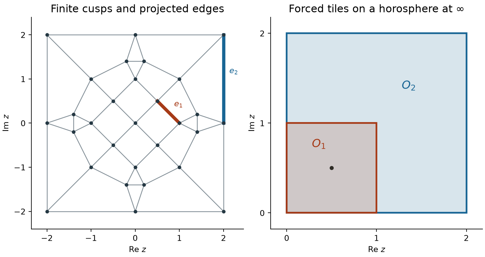

# A 528-chamber counterexample to Conjecture 7.11

There is a convex ideal right-angled SW2 polyhedron of volume **eleven regular ideal octahedra** which admits no tiling by regular ideal octahedra. Two of its boundary edges force tiles whose interiors overlap. This addresses Conjecture 7.11 as stated in v1 of Allcock, Devlin, Felikson, Kontorovich and Whitehead. Their Proposition 7.10 supplies a tiling of this example by 44 quarter-octahedra. [Definition 2.1](https://arxiv.org/html/2609.05349v1#S2.SS1) · [Proposition 7.10 and Conjecture 7.11](https://arxiv.org/html/2609.05349v1#S7.SS4)

## The polyhedron

Use the upper half-space model with complex coordinate z on the ideal boundary. Let D₄ act by quarter turns about 0 and by complex conjugation. Take the hyperbolic convex hull P of ∞ and the D₄-orbits of the following seven points.

    0,  1,  2,  1+i,  2+2i,  (1+i)/2,  (7+i)/5.

This gives 29 finite cusps and ∞. The four vertical faces lie over the sides of the square [−2,2]². The other supporting planes are hemispheres with the following centers and radii, taking the D₄-orbit of each center. [Two-page proof with figure](counterexample-528.pdf)

| Center | Radius | Number |
|---|---:|---:|
| 2+i | 1 | 8 |
| 1+i/2 | 1/2 | 8 |
| 1/2 | 1/2 | 4 |
| 5/3 | 1/3 | 4 |
| 5/4 | 1/4 | 4 |

The hull has 8 triangular and 24 quadrilateral facets. Each of its 60 edges has angle π/2. One can check the facet list using triples of the 30 cusps. For two adjacent hemispheres, the squared distance between their centers is the sum of their squared radii. A hemisphere meeting a vertical face at an edge has its center on that face's boundary line.

## The two forced tiles

Every vertex of a contained ideal octahedron belongs to the cusp set of P. Indeed, a point on the unit sphere of the Klein model is extreme in the closed ball. It can belong to the convex hull of a finite set of points of the ball only if it is in that set.

Every tiling of P must put an octahedral edge on each boundary edge e of P. Take an ordinary point in the interior of e. The two supporting planes of P there force the face of any tile containing that point to have dimension at most one. Since all tile vertices are ideal, the point lies on a tile edge. That edge has the same two ideal endpoints as e. The tile fills the right angle at e, so its two incident faces lie in the supporting planes of P. This argument allows tiles to meet along only part of a face.

For s equal to 1 or 2, write Oₛ for the regular ideal octahedron with vertices

    ∞,  0,  s,  is,  s+is,  s(1+i)/2.

The edge with endpoints 2+2i and 2 forces O₂. The edge with endpoints 1 and (1+i)/2 forces O₁. Here is the complete local check. For the first edge use the facet with cusps {∞, 2+2i, 2, 2−2i}. For the second use the facet with cusps {0, 1, (1+i)/2, (1−i)/2}. The triangular face of a tile at the edge must take its third vertex c from the other two cusps of that facet. Each such triangle gives exactly two possible regular octahedra.

| Edge | Third cusp c | First completion | Second completion |
|---|---|---|---|
| 2+2i, 2 | ∞ | Contains 3+i, absent from P | O₂ |
| 2+2i, 2 | 2−2i | Contains (14+2i)/5, absent | Contains (6+2i)/5, absent |
| 1, (1+i)/2 | 0 | Contains 1/2, absent | O₁ |
| 1, (1+i)/2 | (1−i)/2 | Contains 1/2, absent | Contains (3+i)/2, absent |

To verify each row, take the Möbius map M sending 0, ∞, 1 to the edge endpoints in the order shown and to c. The three additional vertices are M(±i), M(1±i), M((1±i)/2), taking the same sign throughout.

High on a horosphere at ∞ the sections of O₂ and O₁ are the squares [0,2]² and [0,1]². Their interiors overlap. For example, the point above (1/2,1/2) at height 3 lies strictly inside both octahedra. This proves the obstruction.



## Verification in the SW2 tessellation

To use the integral Lorentz frame of the chamber search, set ζ = z+3+2i. A hemisphere of radius 1/d and center (a+ib)/d in the ζ coordinates has outward normal

    n = (t, a, b, t−d),    t = (a²+b²+d²−1)/(2d).

The displayed circles and the four vertical sides give integral normals of Lorentz norm one. Every such wall belongs to SW2. To see this, apply the signed spatial permutations generated by the simple mirrors 1, 3, 4 and choose the sign of the normal so that t is nonnegative and x ≥ y ≥ z ≥ 0. For t > 0, the norm equation gives t < x+y+z < 3t. Reflection in (1,1,1,1) changes t to 2t−x−y−z and strictly decreases |t|. At t = 0 the spatial part is a coordinate unit vector, conjugate to the simple normal of face 3. Consequently the supporting planes of P are walls of the SW2 tessellation.

An exact flood across adjacent chambers reconstructs 528 distinct SW2 tetrahedra and recovers the original cusp hull. GAP also computes index 528 for the subgroup of the SW2 Coxeter group generated by the 32 facet reflections. A separate cusp enumeration finds 27 regular ideal octahedra contained in P. Its boundary edges force 12 distinct ones, giving a second obstruction since P has room for only 11.

## Reproduce

Python 3.11+ and its standard library suffice for the geometric check. From this directory run

```sh
python3 counterexample.py
python3 verify.py results/counterexample-528.toml.gz --check results/counterexample-528.json.gz
```

The first command starts from the seven points above. The second starts from the saved list of chamber words. For the independent coset enumeration run

```sh
gap -q -b results/counterexample-528.g
```

To rerun the search that found this configuration, use

```sh
python3 cusp_search.py all3 4 4 4 failed.jsonl.gz --origin 1 0 --screen
python3 check_cusps.py failed.jsonl.gz --write witnesses.jsonl.gz
```

This enumerates 563 embedded configurations in the specified rectangle and curvature range. The edge test isolates the example above. An exact search over all placements gives the same obstruction. The unrestricted chamber census through 252 gives a lower bound on the size of a counterexample. This construction gives an upper bound of 528.
